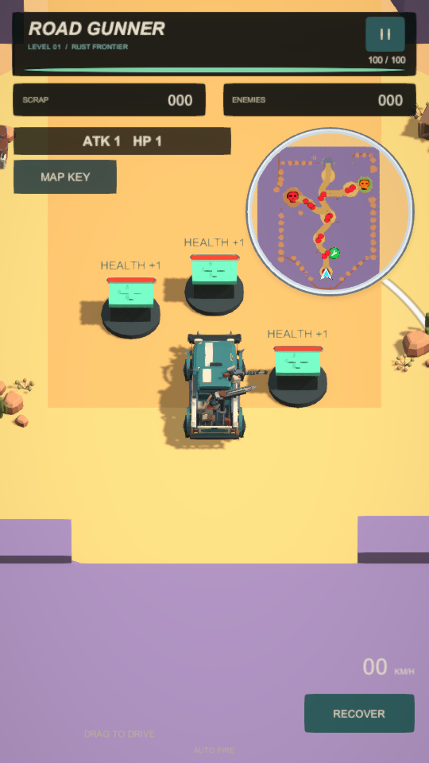

# Road Gunner — новая планировка арены 1

Дата интеграции: 25–26 октября 2026. Это правка существующей Greenwood-сцены и её систем.

## Арена 1

Арена 1 теперь проходит по извилистой северной дороге шириной 14 м. Первые 50 м остаются прямыми для обучения. У ранней правой развилки расположена действующая ремонтная мастерская, повёрнутая открытым въездом к дороге (yaw 135°); дальше отдельная левая дорога ведёт к Boss Raider, северная — к видимым закрытым воротам с площадкой для разворота, дальняя правая — к Monster. Ветки к боссам имеют ширину 16 м; диаметры боевых площадок — 48 и 40 м. Скальные полосы физически закрывают срезы через открытое поле.

Существующие 12 Raiders, 2 Buggies, Monster и Boss Raider сохранены. Raiders распределены парами вдоль дороги и ветвей; Buggies стоят на отдельных площадках диаметром 38 м. Attack +1 перенесён на левую ветку. Три стартовых разрушаемых объекта Health +1 используют существующую систему улучшений независимо друг от друга. У каждого 10.5 прочности: два базовых попадания по 5.25. Каждое уничтожение даёт один уровень, все три доводят HP 1 → 4 и максимум 100 → 160. Они не дают kill/Scrap, не выдаются от близости и восстанавливаются при Restart. Однострочные HEALTH +1 остаются над полосками прочности.

Координаты ниже: W — существующая система Arena1Installer.World(east,north), 1 единица W = 2,5 м, оси повёрнуты на 45° под игровую камеру. Unity XYZ указаны в метрах; высота снимается с существующей поверхности/NavMesh.

| Объект | W (вправо, вверх) | Unity XYZ, м |
|---|---:|---:|
| Игрок | (0, -48) | (-84.85, 0.70, -84.85) |
| Здоровье 1 | (-1.4, -46) | (-83.79, 0.00, -78.84) |
| Здоровье 2 | (0, -45.5) | (-80.43, 0.00, -80.43) |
| Здоровье 3 | (1.4, -47.5) | (-81.49, 0.00, -86.44) |
| Ремонтная мастерская | (8, -27) | (-33.59, 0.00, -61.87) |
| Attack +1 | (-14, 20) | (10.61, ≈0, 60.10) |
| Boss Raider | (-34, 30) | (-7.07, 0.03, 113.14) |
| Monster | (39, 43) | (144.96, 0.20, 7.07) |
| Подъезд к закрытым воротам | (2, 56) | (102.53, ≈0, 95.46) |
| Закрытые ворота | (2, 59) | (107.83, 0.00, 100.76) |
| Закрытая северная арена | (2, 65) | (118.44, ≈0, 111.37) |

Позиции пар Raiders в W: (-1.7,-30)/(1.7,-27), (-8,-14)/(-5.5,-10), (1,7)/(4,11), (-5.2,29)/(-2.8,33), (-16,22)/(-21,26), (22,37)/(27,40). Buggies: (2,10), (25,38).

Проверено в полном фактическом запуске Unity: все 12 Raiders имеют полный путь NavMesh от старта; машина непрерывно проехала основную дорогу 285,3 м и ветви Boss 101,4 м / Monster 111,7 м. Максимальное отклонение от центра основной дороги — 0,4 м, колёса не отрывались от земли. Закрытые ворота видимы, имеют реальные коллайдеры и выдержали подъезд на максимальной скорости. Создано 207 статических коллайдеров скальных полос; старые мешающие объекты перемещены целиком или сохранены выключенными. Старые исходные объекты и прежняя сеть дорог остаются в иерархии; прежние дороги выключены.

В текущем проекте нет системы задания/условий открытия этих ворот. Северная площадка обозначена и физически закрыта существующим prefab ворот; новая логика квестов не добавлялась.

## Машина

Ранее при отпускании оставались только слабые тормоза колёс `coastBrakeTorque=50` и небольшое сопротивление движению; отдельного гарантированного торможения по времени не было. Время остановки старого публичного билда отдельно не измерялось.

Теперь при нулевом вводе в FixedUpdate горизонтальная скорость плавно стремится к нулю через `coastDeceleration=11.5 м/с²`; порог покоя `0.08 м/с`. Вертикальная скорость, гравитация и подвеска сохраняются. Высокий глобальный drag не добавлен. Лимит 11.7 м/с, ускорение и плавное движение носом по направлению плавающего стика сохранены. Фактическая проверка на ровной площадке после разгона колёс: обычная скорость 10.202 м/с → ≤0.2 м/с за 0.871 с, полный ввод с достигнутой скоростью 10.474 м/с → ≤0.2 м/с за 0.902 с, низкая 2.894 м/с → за 0.221 с. Лимит команды 11.7 м/с отличается от достигнутой равновесной скорости 10.474 м/с из-за существующей кривой тяги и сопротивления; они не менялись. Итоговые измерения находятся в PlayMode.txt.

## Мини-карта

Сохранена недорогая статическая выпечка настоящей геометрии сверху: текстура 512×512, один RawImage, общая круглая stencil-маска для карты и маркеров. Карта фиксирована по направлению главной дороги вверх; не вращается за машиной. Полный маршрут и важные площадки помещаются внутри круга с запасом. Level Editor обновляет выпечку при Save Level.

Из приложенного изображения взяты общие принципы: мягкая серая круглая рамка, тень, крупные цветные области, хорошо заметные дороги и простые точки. Активы изображения не копировались. Реальные материалы дорог золотистые, площадки жёлтые/зелёные/ржавые, непроезжие скалы светло-лиловые. Убраны мелкие детали и ложные внутренние швы скальной массы, создававшие сетку.

| Объект | Маркер | Размер в Canvas |
|---|---|---:|
| Игрок | Белая/голубая стрелка | 36 |
| Raider, Buggy, Attack +1, Health +1 | Одинаковая красная точка | 16 |
| Мастерская | Зелёный круг, белый ключ | 30 |
| Monster | Оранжевый череп | 29 |
| Boss Raider | Красный череп | 32 |

Все точки берут настоящие мировые координаты. Уничтоженные враги и использованные улучшения исчезают с карты. Список целей кэшируется; обновление маркеров каждые 0.08 с без поиска сцены в каждом кадре.

## Коллизии

Причина: часть крупного окружения, включая десять Boulder, была сохранена как оформление без Collider после старого объединения мешей. Коллайдеры кузова и ContinuousDynamic уже существовали; основная матрица слоёв препятствия не исключала.

Добавлена единая политика GameplayObstacleAuthoring для миграции сцены и будущих размещений в Level Editor. Крупные камни, стены, заборы, обломки машин, контейнеры и существенные части комбинированных декораций получают недорогие BoxCollider. Существующие составные формы ворот сохраняют реальные проёмы. Мелкая трава, галька и мусор остаются без блокировки.

Среда использует Default(0), обычные включённые non-trigger коллайдеры, без include/exclude overrides. Игрок Player(8), Buggy(11), столкновения с Default включены. Мягкие Raiders(9) по прежнему не сталкиваются с кузовами. Кузов игрока остаётся динамическим, с двумя существующими корпусными коллайдерами и ContinuousDynamic; оружие и спутник не стали частью физического корпуса. Добавлено 207 статических примитивов для контуров скал. Миграция существующего окружения при первом запуске добавила 206 примитивов и классифицировала 312 препятствий; повторный запуск не дублирует их. NavMesh пересчитан.

## Файлы

Основные runtime-правки: ArenaCorridorLayout, ArenaUpgradeStation, TurretController, VehicleController, VehicleTuning, ArenaMinimap, ArenaMinimapIcon.

Authoring: CorridorArenaInstaller, CorridorRevisionInstaller, UpgradeOnboardingInstaller, CorridorMinimapStyler, ArenaMinimapBaker, CasualPolishInstaller, EnemyHealthBarAuthoring, GameplayObstacleAuthoring, RoadGunnerLevelAuthoring, RoadGunnerLevelEditorWindow. Диагностика: Arena1PlayChecks/Arena1Verification и CorridorUpgrade/Route/PhysicsChecks; существующие health/map проверки расширены для новой сцены.

Сохранены Level01_Greenwood.unity, её Navigation.asset, Arena 1 vehicle handling.asset, текстура карты и новые меши/материалы в Levels/Greenwood/Arena1/Corridor. Обновлены существующие enemy prefab UI: Wasteland Enforcer, Wasteland Veteran, Forest Scavenger, Tree Sentinel, West Champion, Rust Vulture Enemy Buggy, Wasteland Raider. Коллайдеры окружения — overrides экземпляров сцены, исходные художественные prefab не заменялись.

## Проверка и публикация

Полный Play Mode завершён: **187 проверок, 0 ошибок; Console errors/exceptions/asserts = 0**. После последней правки только высоты и контраста подписей отдельно повторён старт: **27 проверок, 0 ошибок**, Console = 0 (`Onboarding.txt`).

Проверены непрерывные проезды всех четырёх дорог, въезд в мастерскую, NavMesh всех 12 Raiders, три независимых разрушения настоящим пулемётом, остановки A–E, 20 ударов (камень/обломок/баррикада/бетон/граница × малая/обычная/максимальная/диагональная скорость), удар в сохранённые ворота и Buggy в баррикаду. Фактические скорости ударов: малая2.93–2.94, обычная10.06, максимальная11.18, диагональная11.16 м/с. Проверка предельного удара начиналась с11.7 м/с; это отдельная стресс-проверка выше естественного полного разгона.

Реальный поворот: после3с разгона машина повернула на32.8° за0.35с, отпускание при6.84 м/с дало остановку за0.541с без reverse. Реальное повторное нажатие:9.88 м/с →6.09 после0.35с отпускания →8.38 после0.8с возобновлённого движения. Дополнительно проверен искусственный боковой импульс8+5 м/с; он затух за0.688с.

Сохранены и проверены world HP UI/пулы, белая10м граница во время движения/боя, музыка/громкость/пауза/Restart, InputSystem touch/мышь/WASD и поворот180° носом, Attack +1, ремонт, Metal Gear/гарпун, оба босса и Arena Clear. GPU-проверка подтверждает круговую обрезку карты и значков.

Подробный результат фактического Play Mode: PlayMode.txt. Сохранённая интеграция и координаты: Integration.txt, Layout.txt. Результаты WebGL и GitHub Pages: Publication.txt.

Ограничения: физический телефон и аппаратная производительность Safari/Android не проверялись. Квестовой системы открытия северных ворот в исходном проекте нет; ворота намеренно остаются видимо и физически закрытыми. Точное расположение из The War не выдаётся за проверенное: текущая планировка следует последнему заданию пользователя.
